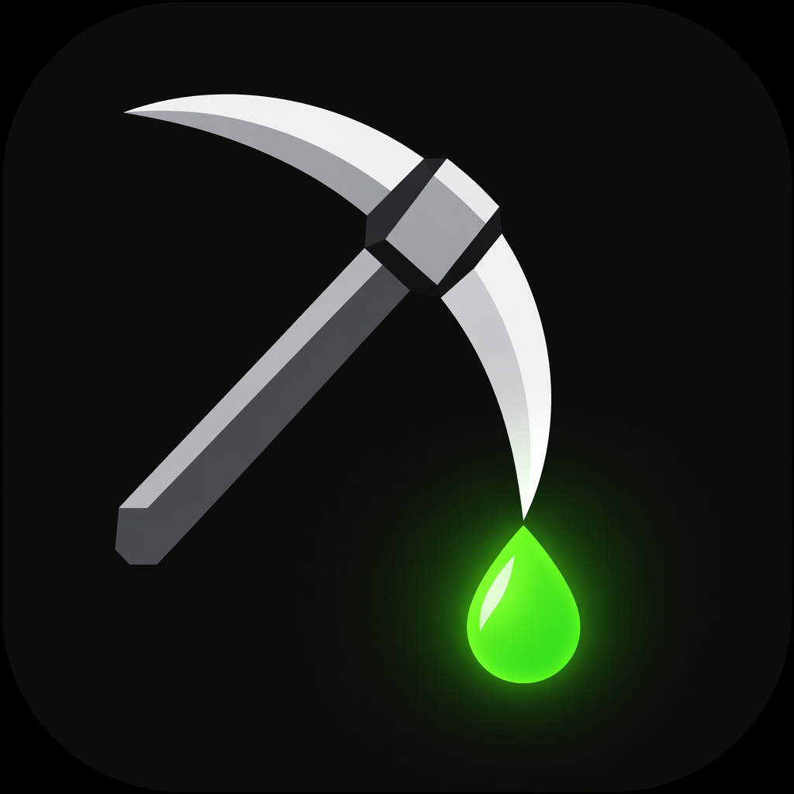

# KickHarvest

Automatically watch [Kick.com](https://kick.com) streams to farm viewing rewards (**drops**) — silently, in the background, on Windows, Android, and in the browser.

One small tool, three forms:

| Platform | Artifact | Notes |
| --- | --- | --- |
| Windows | `KickHarvest.exe` (portable) | Hidden player, 160p quality, tray icon, auto-start |
| Android | `KickHarvest.apk` | WebView app, screen stays on |
| Any browser | `index.html` | Single file, zero install |

## Features

- **Queue of channels** with per-channel watch targets or one shared goal (sum across channels) — for global drops like the GTA 6 "Sunset Drop".
- **Smart switching** — no manual rotation timers: when a streamer goes offline (confirmed by two checks), the app moves to the next channel. With a drop category set (e.g. `GTA`), it also switches when the streamer changes games, and marks eligible channels with a **DROP** badge.
- **Drop progress panel** (desktop app) — lists active campaigns, progress bars per reward, claim status, and a "add live streamers of this game" button that finds channels currently streaming the campaign's category.
- **Hidden background player** (desktop) — the stream plays in an invisible window: muted, video hidden, forced 160p quality to save bandwidth and CPU. Minimize to tray and keep farming overnight with the monitor off.
- **Notifications** — the desktop app polls your drop progress every 10 minutes and notifies you when a reward reaches 100%. Progress is also shown in the tray tooltip.
- **Login workflow** — one click opens Kick in a dedicated window; the session is remembered. Drop progress is then fetched from Kick's own API with your session.
- **Persistence** — channels, watch times and settings survive restarts.
- **Wake Lock** — on phones (app or web) the screen stays on while the app is open.

## Verified facts about Kick drops

- Drop time is counted only by the **full kick.com site on a logged-in account**. The embedded player (`player.kick.com`) does not talk to the drops system at all.
- Eligible streams are per **game category** — e.g. the "Sunset Drop" (Nov 18 2026 – Jan 1 2027, reward "SunsetK Badge") counts time on any stream in the GTA 6 category.
- Required watch time: **250 hours** for the SunsetK Badge (Kick's `required_units` are minutes; 15000 units = 250 h).

## Quick start

### Windows

1. Download `KickHarvest.exe` (portable, no installation).
2. Run it. Windows SmartScreen may warn about an unknown publisher — click *More info → Run anyway*.
3. Add a channel (e.g. `xqc`), optionally set the drop category (`GTA`), press **START**.
4. Click **Zaloguj się na kick.com** once to connect your account, then **Odśwież postęp dropów** to see live progress.
5. Close the window (X) — the app keeps working in the tray. Tick *uruchamiaj z Windowsem* to start it with the system.

### Android

1. Copy `KickHarvest.apk` to the phone and open it (allow "unknown sources").
2. Add channels and press START. The screen stays on while the app is open.
3. Note: Android pauses background apps — with the screen off, watch time does not accrue. For overnight farming use the PC.

### Browser

Open `index.html` in any modern browser. The "separate window" mode (a real Kick tab) is the most reliable way to count drops; the in-page modes need third-party cookies allowed for this page.

## How it works

The app is a single-file core UI (`index.html`) with two thin native shells:

- `desktop/` — Electron app. The renderer is the same `index.html` (synced by `sync.js`). Native extras live in `main.js`/`preload.js`: a hidden player window with injected mute/hide/160p, Kick API fetches from inside a real kick.com page (Cloudflare blocks plain requests from Node), login window, tray, notifications, "start with Windows".
- `android/` — minimal Gradle project (AGP, no Kotlin, no AppCompat). A WebView loads `index.html` from assets with `?android=1` (hides the popup mode), third-party cookies enabled, screen kept on.

Live status and game category of channels come from Kick's public API (`kick.com/api/v2/channels/{slug}`), checked every ~20 seconds.

## Building

- Windows app: `cd desktop && npm install && npm run dist` → `dist/KickHarvest.exe`. Dev run: `npm start`.
- Android: needs JDK 17+, Android SDK (platform 35), Gradle 8.9. `gradle assembleDebug` in `android/` → `app/build/outputs/apk/debug/app-debug.apk`.
- Icons: generated from `assets/logo.png` via `desktop/resize_logo.ps1`.

## Privacy

Credentials are never stored by KickHarvest. Login happens directly on kick.com (Kick's own login page); the app only keeps the browser session cookies in its local profile. No analytics, no telemetry.

## Disclaimer

KickHarvest is an unofficial third-party tool. It automates watching streams on your own account; use it in accordance with Kick's Terms of Service. It cannot guarantee that Kick credits watch time — always verify progress at [kick.com/drops](https://kick.com/drops).

## License

[MIT](LICENSE)
